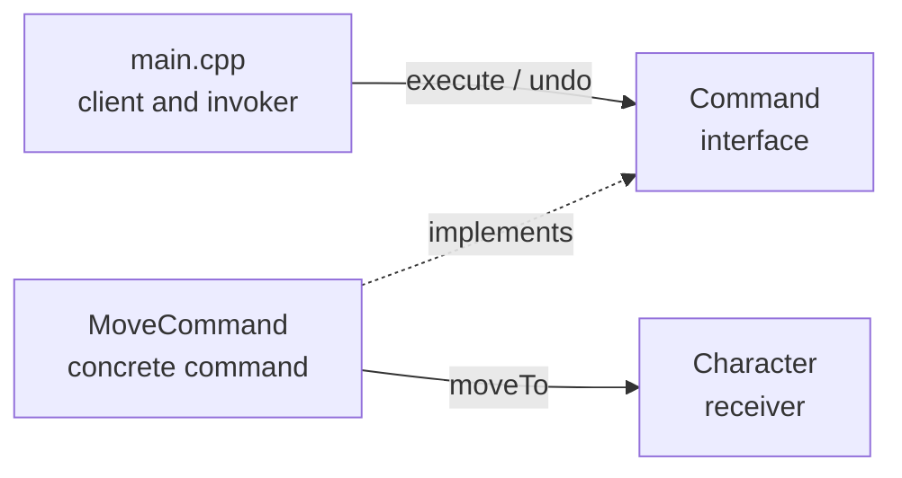

# Command Pattern

The Command pattern turns a request into an object. A caller can store commands,
run them later through one interface, and reverse them, without knowing what each
command does.

## How It Works



| Role | Class | Responsibility |
| --- | --- | --- |
| Command | `Command` | Interface with `execute()` and `undo()`. |
| Concrete command | `MoveCommand` | Moves a character; remembers the previous position for undo. |
| Receiver | `Character` | Holds the name and position. |
| Client / invoker | `main()` in `src/main.cpp` | Creates commands, runs them in order, undoes them in reverse. |

Undo runs in reverse order so the most recent action is reversed first, like popping
a stack. Commands are owned by `std::unique_ptr`, so nothing is leaked.

## Project Layout

```text
command/
  CMakeLists.txt             Build definition
  include/command/           Public headers
    Character.hpp
    Command.hpp
    MoveCommand.hpp
  src/                       Implementations and the demo entry point
    Character.cpp
    MoveCommand.cpp
    main.cpp
  tests/
    command_tests.cpp        Checks execute and undo behavior
  build/                     Generated output; ignored by Git
```

`Character` and `MoveCommand` are built as a small library, `command_lib`. The demo
(`command_demo`) and the test (`command_tests`) both link to it, so the logic is
compiled once and `main()` is never shared.

## Build, Test, and Run

Requires `g++` (C++17), CMake 3.16 or later, and Ninja. Run from this folder:

```bash
cmake -S . -B build -G Ninja -DCMAKE_BUILD_TYPE=Debug   # configure
cmake --build build                                     # build
ctest --test-dir build --output-on-failure              # test (CMake 3.20+)
./build/command_demo                                    # run
```

In VS Code, `Ctrl+Shift+B` configures and builds, and **Tasks: Run Task** offers
`command: test` and `command: run`. Re-run configure only when `CMakeLists.txt`
or the file list changes; otherwise `cmake --build build` is enough.

To start clean, delete the `build/` folder and configure again.

## Expected Output

Positions are random, but each undo returns to the position before that move,
ending at the starting point `(0, 0)`:

```text
Hero moved to (8, 1)
Hero moved to (0, 2)
Hero moved to (6, 9)
Hero moved to (4, 8)
Hero is back at (6, 9)
Hero is back at (0, 2)
Hero is back at (8, 1)
Hero is back at (0, 0)
```

## Adding a New Command

1. Add `include/command/<Name>Command.hpp` and `src/<Name>Command.cpp`,
   implementing `Command`.
2. Add the `.cpp` file to `command_lib` in `CMakeLists.txt`.
3. Add a case to `tests/command_tests.cpp`, then rebuild and run the tests.

## When to Use It

- Undo and redo history.
- Queues of work executed later.
- Game or UI input mapped to interchangeable actions.

For one immediate action with no history or queuing, a plain function call is simpler.
