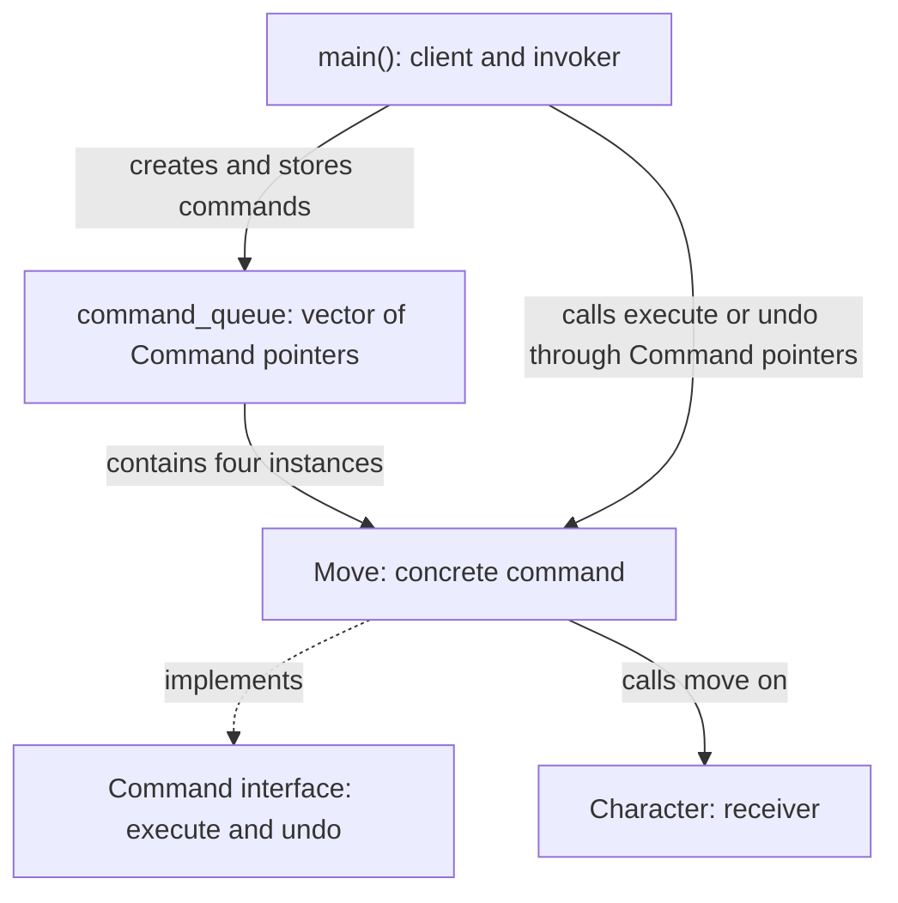

# Command Pattern

## What Is It?

The Command pattern is a behavioral design pattern that represents a request as
an object. Instead of performing an action immediately, a caller can create a
command, store it, and execute it later through a common interface.

The caller knows how to trigger a command without needing to know how the action
works. This separates deciding **when** to do something from knowing **how** to
do it.

An undoable command also keeps enough information to reverse its action. Undo
is a capability we can build using commands, not something the pattern provides
automatically.

## This Example

The program creates a character named `Hero` and queues four movement commands.
Each command chooses a destination when it executes and asks the character to
move there.

| Pattern Role | In This Example | Responsibility |
| --- | --- | --- |
| Client | `main()` | Creates the character and the four commands. |
| Invoker | The loops in `main()` | Executes commands and requests undo without depending on movement details. |
| Command interface | `Command` | Declares the `execute()` and `undo()` operations. |
| Concrete command | `Move` | Implements the movement request and stores its destination. |
| Receiver | `Character` | Holds the character's state and changes its position through `move()`. |
| Command collection | `command_queue` | Stores command pointers in a vector for later execution. |

Here, `main()` acts as both client and invoker. The character is passed to each
operation rather than stored inside the command.

## How the Parts Connect



The important boundary is between the invoker and the command interface. A new
action can implement `Command` and be added to the same collection without
changing how the execution loop dispatches commands.

## Execution Flow

1. Create the `Hero` character.
2. Create four separate `Move` objects and store their pointers in the vector.
3. Execute commands in insertion order: **1, 2, 3, 4**.
4. Each execution chooses random X and Y coordinates from **0 through 9**, sets
	 the character's position, and prints the destination.
5. Request undo in reverse order: **4, 3, 2, 1**.
6. Each undo call updates the position and prints a message.

Reverse order matters for real undo: the most recent action should be reversed
first, like removing the top item from a stack.

## Important Limitations

This example demonstrates command dispatch and reverse traversal, but it does
**not** implement correct position restoration yet:

- `Character::move()` sets an absolute position; it does not add a movement offset.
- `Move` stores its destination, not the character's previous position. Its
	`undo()` sets the position to the negated destination. For example, a move from
	`(2, 3)` to `(7, 4)` should undo to `(2, 3)`, not `(-7, -4)`.
- The character's initial coordinates are not initialized. A proper undo design
	needs a defined starting position and must capture the old position before
	each move.
- The commands are allocated with `new` but are not deleted. A production
	implementation needs explicit ownership, typically through smart pointers.
- There is no redo history. Executing a `Move` again chooses a new destination
	rather than replaying the original one.

For correct undo, each command would remember the previous position before
execution and restore it during undo. For repeatable redo, it would also retain
and reuse the original destination.

## Build and Run

Requirements: a C++ compiler with **C++11 or later** support. The commands below
use `g++` on Linux. No external libraries or CMake configuration are required
for this single-file example.

From the repository root (`Desing_Patterns`):

```bash
mkdir -p command/build
g++ -std=c++11 command/main.cpp -o command/build/main
./command/build/main
```

The program prints four `Hero moved to (...)` messages, followed by four
`Hero moved back to (...)` messages. The latter describe the current negation
behavior, not a correctly restored movement history.

Build outputs go into the ignored `command/build/` directory. When using an
editor build task, select `g++` or `clang++` so the C++ standard library is
linked correctly.

## When to Use It

- Editor actions that need undo and redo history.
- Work queues that separate request creation from execution.
- Game input mapped to interchangeable actions.
- Callbacks represented as objects, especially when they need stored state.
- Action logging or replay, provided the command data is designed to be recorded
	and replayed reliably.

For a single immediate action with no need for queuing, history, or interchangeable
behavior, a direct function call may be simpler.