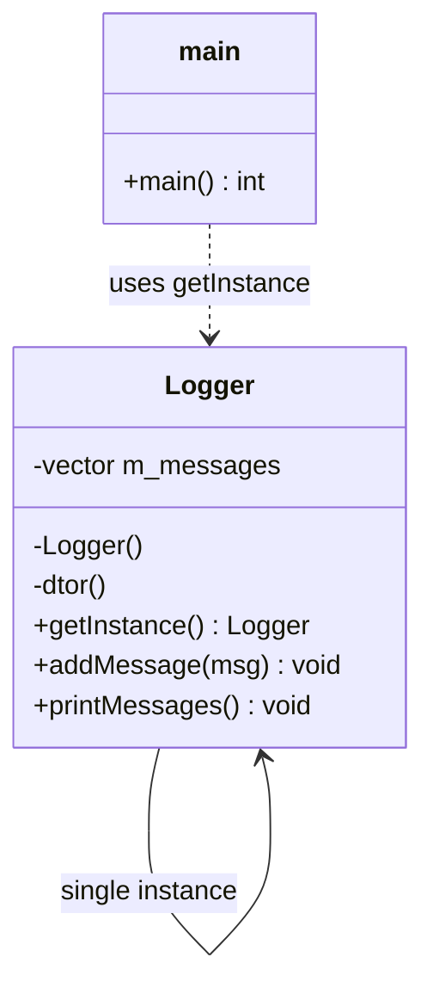
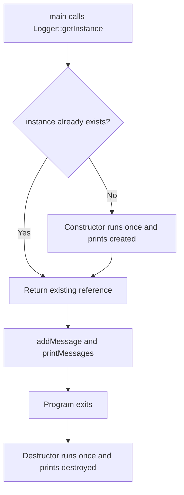

# Singleton Design Pattern: Logger

A small C++17 project that demonstrates the **Singleton** design pattern using a `Logger` class.

## Project Structure

```text
singleton/
├── include/
│   └── Logger.hpp      # class declaration (the "what")
├── src/
│   ├── Logger.cpp      # method definitions (the "how")
│   └── main.cpp        # client code (the "use")
├── CMakeLists.txt      # build configuration
└── README.md
```

## Build and Run

```bash
cmake -S . -B build        # configure; generated files go to build/
cmake --build build        # compile and link
./build/singleton          # run
```

## Concept: Singleton

**Singleton** ensures a class has **exactly one instance** and provides **one global access point** to it.

Use it when exactly one object should coordinate a resource, for example:

- A logger
- A configuration manager
- A hardware or device handle
- A thread pool or connection pool

### The three rules of a Singleton

| Rule | Why |
|---|---|
| 1. Constructor is private | Outside code cannot create objects with `new` or on the stack. |
| 2. Copy and move are deleted | Outside code cannot duplicate the instance. |
| 3. A static accessor returns the instance | `getInstance()` is the only way to reach the object. |

## How It Is Implemented

### 1. Private constructor and destructor

```cpp
private:
    Logger();   // only getInstance() can call this
    ~Logger();
```

### 2. Deleted copy and move operations

```cpp
Logger(const Logger&) = delete;
Logger& operator=(const Logger&) = delete;
Logger(Logger&&) = delete;
Logger& operator=(Logger&&) = delete;
```

These are compile-time guards. Any copy attempt is a compile error, not a runtime bug.

### 3. Meyers' Singleton (static local variable)

```cpp
Logger& Logger::getInstance() {
    static Logger instance;   // created on first call, destroyed at program exit
    return instance;
}
```

Why this form:

- **Lazy initialization:** the object is created only when first needed.
- **Thread-safe initialization:** since C++11, the compiler guarantees that the static local is initialized exactly once, even with multiple threads.
- **No memory leak:** no raw `new`, so no manual `delete` is needed. The destructor runs automatically at exit.

### 4. Returning a reference

`getInstance()` returns `Logger&`, not a pointer. The caller always gets a valid object, and it cannot pass `nullptr` or `delete` the instance.

## Code

### include/Logger.hpp

```cpp
#pragma once

#include <string>
#include <vector>

class Logger {
public:
    Logger(const Logger&) = delete;
    Logger& operator=(const Logger&) = delete;
    Logger(Logger&&) = delete;
    Logger& operator=(Logger&&) = delete;

    static Logger& getInstance();

    void addMessage(const std::string& msg);
    void printMessages() const;

private:
    Logger();
    ~Logger();

    std::vector<std::string> m_messages;
};
```

### src/Logger.cpp

```cpp
#include "Logger.hpp"
#include <iostream>

Logger& Logger::getInstance() {
    static Logger instance;
    return instance;
}

Logger::Logger() {
    std::cout << "Logger instance created.\n";
}

Logger::~Logger() {
    std::cout << "Logger instance destroyed.\n";
}

void Logger::addMessage(const std::string& msg) {
    m_messages.push_back(msg);
}

void Logger::printMessages() const {
    std::cout << "--- Printing Messages ---\n";
    for (const auto& msg : m_messages) {
        std::cout << msg << '\n';
    }
}
```

### src/main.cpp

```cpp
#include "Logger.hpp"

int main() {
    Logger::getInstance().addMessage("Hello, singleton message 1");
    Logger::getInstance().addMessage("Hello, singleton message 2");
    Logger::getInstance().addMessage("Hello, singleton message 3");

    Logger::getInstance().printMessages();

    // Logger l;                 // compile error: constructor is private
    // Logger copy = getInstance(); // compile error: copy constructor is deleted

    return 0;
}
```

### CMakeLists.txt

```cmake
cmake_minimum_required(VERSION 3.12)
project(SingletonPattern CXX)

set(CMAKE_CXX_STANDARD 17)
set(CMAKE_CXX_STANDARD_REQUIRED ON)

include_directories(include)

add_executable(singleton
    src/main.cpp
    src/Logger.cpp
)
```

## Class Diagram



## Execution Flow



## Pros and Cons

| Pros | Cons |
|---|---|
| Guaranteed single instance | Hidden global state makes dependencies unclear |
| Lazy, thread-safe creation (C++11+) | Harder to unit test (hard to replace with a mock) |
| Automatic cleanup, no leaks | Shared mutable state needs locking for multithreaded writes |
| Simple to use | Destruction order between singletons can be tricky at exit |

**Note on thread safety:** the *creation* of the instance is thread-safe. `addMessage` is **not** thread-safe, because `std::vector::push_back` from multiple threads at once is a data race. Add a `std::mutex` if several threads will log at the same time.

## Key Takeaways

- Keep the constructor **private** and the copy and move operations **deleted**.
- Use a **static local** inside `getInstance()` (Meyers' Singleton) instead of `new`.
- Return a **reference**, not a pointer.
- Use the `.hpp` for declarations and the `.cpp` for definitions, and never define a method in both.
- Singletons are a useful tool, but they add global state. Use them only when one instance is truly required.